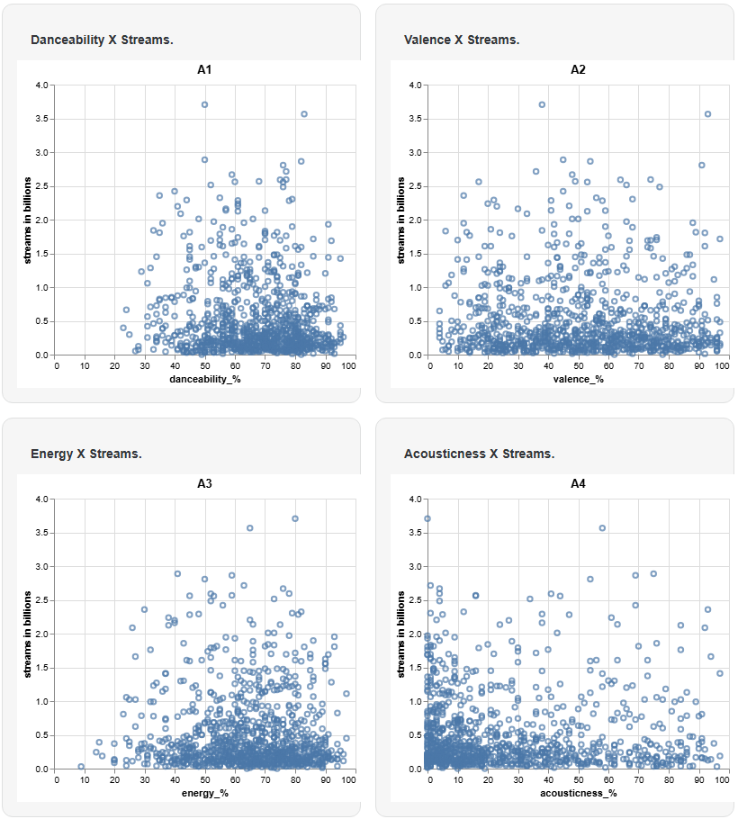
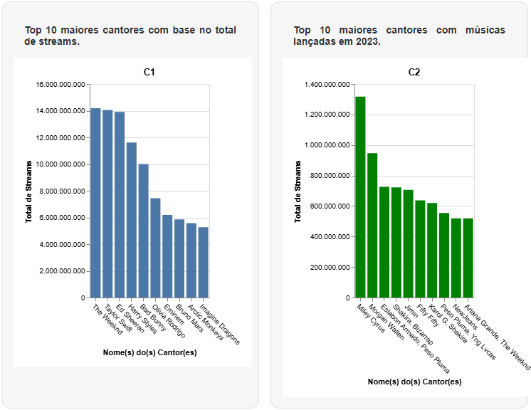
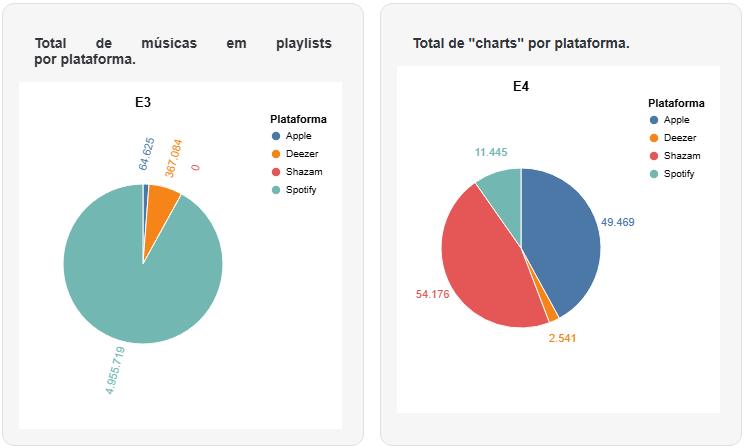

# Spotify 2023: Data Visualization Study

[](https://github.com/cris33rj/spotify-2023-data-visualization/actions/workflows/deploy.yml)

An interactive data-visualization report exploring what makes a song popular, how Top 10 rankings shift by release year, and how Spotify, Apple Music, Deezer and Shazam differ, built on the [Top Spotify Songs 2023](https://www.kaggle.com/datasets/nelgiriyewithana/top-spotify-songs-2023) dataset (953 tracks).

**🔗 Live site: https://cris33rj.github.io/spotify-2023-data-visualization/**

> Developed as a graduate project for the **Data Visualization** course of the Master's program in Computer Science at Universidade Federal Fluminense (PGC-UFF, Brazil), May 2024. The site content is in Portuguese; this README summarizes it in English.



## Research questions

1. **Popularity:** is there any audio feature that makes a song more likely to become popular?
2. **Top 10 stability:** do the Top 10 songs and artists change significantly when only songs released in the same year are considered?
3. **Platforms:** how do Spotify, Deezer, Apple Music and Shazam differ?

## Key findings

- **Danceability and energy matter most.** Scatter plots of streams against seven audio features show the strongest positive trend for *danceability* and *energy*, while high *speechiness* is associated with fewer streams. Among the 10 most-streamed artists, average danceability and energy range from ~50% to ~80%, while every other feature stays below ~65%.
- **Top 10 rankings change by more than 79%** when filtered by release year. Artists with large catalogs (e.g. The Weeknd, 22 tracks and ~14 billion streams in total) dominate the all-time ranking, while artists with a single 2023 hit (e.g. Miley Cyrus' *Flowers*) lead the 2023-only ranking.
- **Each platform excels at a different feature.** Spotify dominates playlist inclusion (~5 million vs. ~370 thousand on Deezer), while Shazam and Apple Music lead chart appearances. Spotify itself ranks third there. Because the dataset is Spotify-centric, cross-platform comparisons are interpreted with caution.

<p>
  
  
</p>

## Tech stack

| Layer | Tools |
| --- | --- |
| Site / static generation | [Observable Framework](https://observablehq.com/framework) |
| Charts | [Vega-Lite](https://vega.github.io/vega-lite/) via `vega-lite-api` |
| Data processing | Python 3, pandas (Observable data loaders) and client-side JavaScript |
| Deployment | GitHub Actions → GitHub Pages |

## How it works

```
docs/data/spotify-2023.csv ──► docs/*.csv.py (Python data loaders) ──► aggregated CSVs ──┐
             │                                                                          ├──► Vega-Lite charts in Markdown pages
             └──────────────────────────► client-side aggregation (JavaScript) ─────────┘
```

Observable Framework runs each `*.csv.py` loader at build time and serves its stdout as a static CSV, so the published site contains only precomputed data and no backend. The pages embed the loader source code, so readers can inspect how each chart was computed.

## Project structure

```
docs/
├── index.md                     # Home page
├── 1-Apresentacao.md            # Introduction: course, questions, dataset dictionary
├── 2-Popularidade_musical.md    # Q1: audio features vs. popularity
├── 3-Top10.md                   # Q2: Top 10 artists and songs, overall vs. 2023
├── 4-Comparativo.md             # Q3: platform comparison
├── 5-Discussao.md               # Discussion
├── 6-Conclusao.md               # Conclusion
├── *.csv.py                     # Python data loaders
├── showCode.js                  # Renders loader source code on the page
└── data/spotify-2023.csv        # Raw dataset
observablehq.config.js           # Site navigation and theme
```

## Running locally

Requirements: Node.js 18+ and Python 3.11+.

```bash
pip install -r requirements.txt
npm ci
npm run dev      # preview at http://localhost:3000
npm run build    # static site in ./dist
```

## Authors

This project was designed and built jointly by **Edel Melo** and **Cristiano Santana do Nascimento** ([@cris33rj](https://github.com/cris33rj)). Both authors took part in every stage, from the analytical decisions to the code, the charts and the written analysis.

Supervised by Prof. Marcos Lage (UFF).

## Data source

[Top Spotify Songs 2023](https://www.kaggle.com/datasets/nelgiriyewithana/top-spotify-songs-2023) by Nidula Elgiriyewithana, published on Kaggle.
